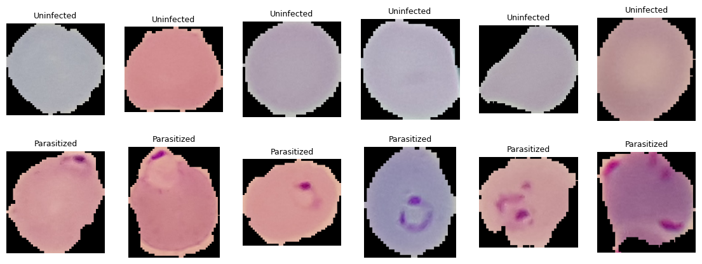
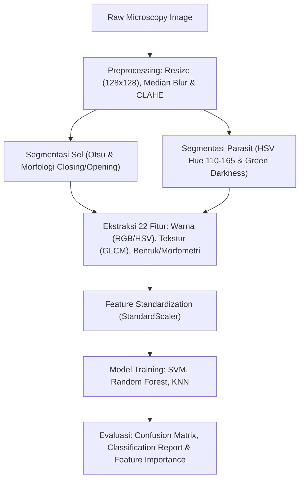
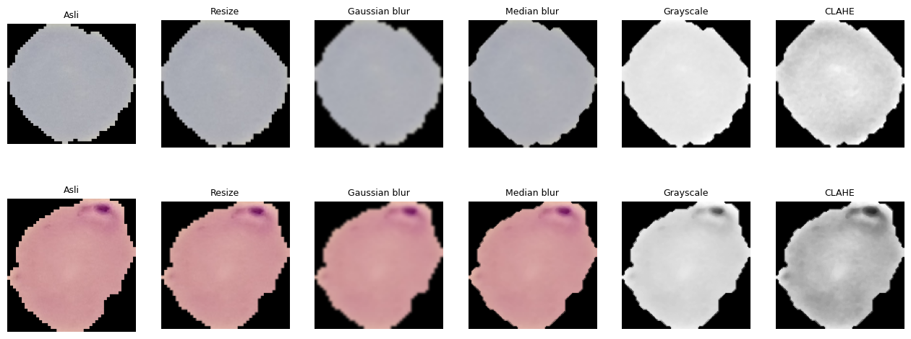
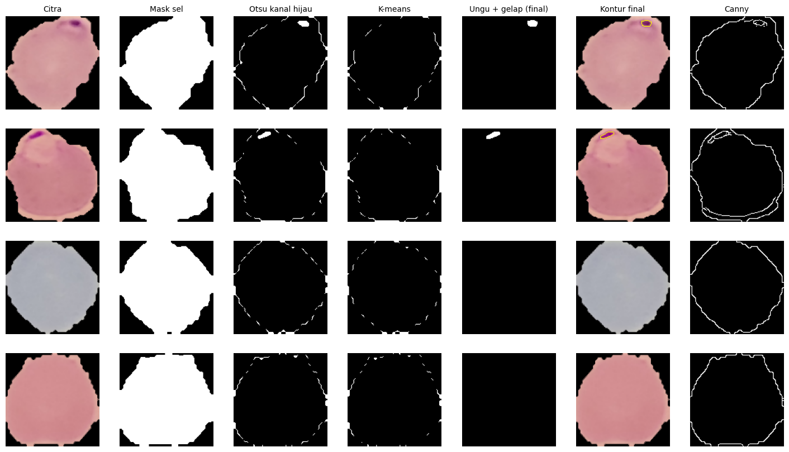
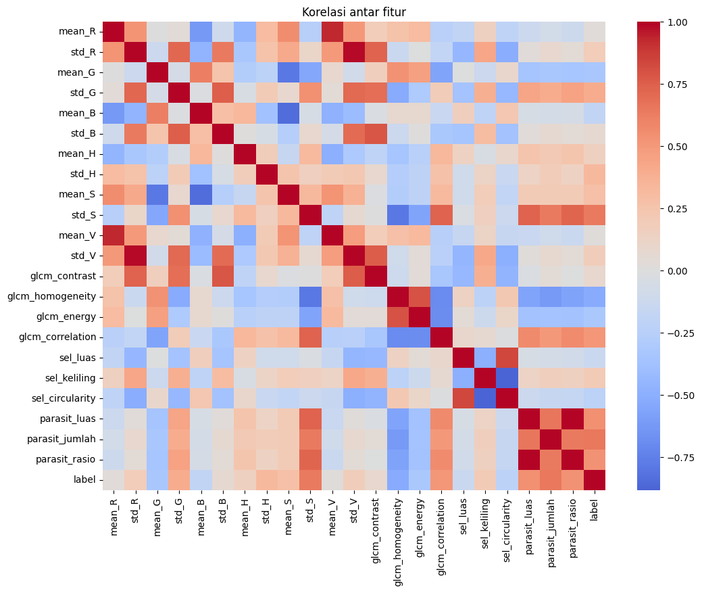
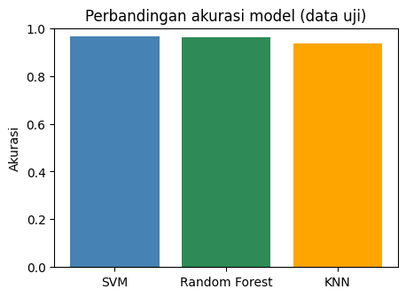
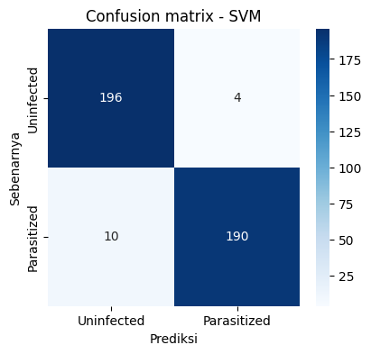
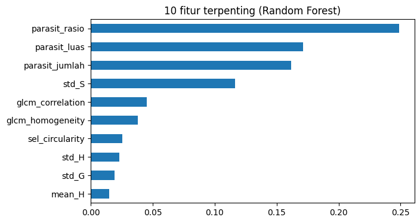

# 🔬 Malaria Cell Classification with Computer Vision & Machine Learning

<p align="center">
  
  
  
  
  
</p>

Proyek ini mengimplementasikan pipeline **Computer Vision** dan **Machine Learning** klasik untuk mendeteksi sel darah merah yang terinfeksi parasit malaria (*Plasmodium*) dari citra mikroskopis apusan darah tipis (*thin blood smear*).

Berbeda dari pendekatan *black-box deep learning*, sistem ini menekankan pada **interpretability** (kemudahan interpretasi) melalui:
1. **Prapemrosesan Citra** (Denoising & Contrast Enhancement).
2. **Segmentasi Bertahap** (Segmentasi Sel Darah & Segmentasi Morfologi Parasit).
3. **Ekstraksi 22 Fitur Handcrafted** (Warna, Tekstur GLCM, dan Morfometri Geometri).
4. **Klasifikasi Klasik** menggunakan **SVM, Random Forest,** dan **KNN**.

---

## 📌 Ringkasan Hasil Utama

| Model | Akurasi Uji | Presisi (Parasitized) | Recall (Parasitized) | F1-Score |
| :--- | :---: | :---: | :---: | :---: |
| 🥇 **SVM (RBF Kernel)** | **96.50%** | **0.98** | **0.95** | **0.96** |
| 🥈 **Random Forest** | **96.25%** | 0.97 | 0.95 | 0.96 |
| 🥉 **K-Nearest Neighbors (KNN)** | **93.75%** | 0.94 | 0.93 | 0.94 |

> 💡 **Kesimpulan:** Model **SVM dengan kernel RBF** mencapai performa tertinggi (**96.5%** akurasi pada data uji 400 sampel) dengan *precision* **98%** dalam mendeteksi sel terparasit, meminimalkan risiko *false positive*.

---

## 📊 Dataset

Dataset yang digunakan berasal dari **NIH (National Institutes of Health)** yang dipublikasikan di Kaggle: [Cell Images for Detecting Malaria](https://www.kaggle.com/datasets/iarunava/cell-images-for-detecting-malaria).

- **Total Citra Asli**: 27,558 citra mikroskopis (*Giemsa-stained*).
- **Kelas**:
  - `Parasitized`: Sel terinfeksi *Plasmodium falciparum*.
  - `Uninfected`: Sel darah merah normal/sehat.
- **Sampel Eksperimen**: 2,000 citra seimbang (1,000 *Parasitized* & 1,000 *Uninfected*).
- **Pembagian Data**: 80% Latih (1,600 citra) & 20% Uji (400 citra).

<p align="center">
  <br>
  <em>Gambar 1: Sampel citra mikroskopis untuk kelas Uninfected (kiri) vs Parasitized (kanan).</em>
</p>

---

## ⚙️ Alur Kerja & Metodologi



---

### 1. Prapemrosesan Citra (Preprocessing)
Citra mikroskopis sering kali mengandung noise bintik dan kontras pewarnaan Giemsa yang tidak merata. Tahapan prapemrosesan meliputi:
- **Resizing**: Standarisasi ukuran menjadi $128 \times 128$ piksel.
- **Median Blur**: Menghilangkan noise bintik halus (*salt-and-pepper*) tanpa mengaburkan ketajaman batas tepi sel.
- **CLAHE (Contrast Limited Adaptive Histogram Equalization)**: Meningkatkan kontras lokal sehingga parasit yang berada di dalam sitoplasma sel tampak lebih kontras.
- **Konversi Ruang Warna**: Konversi ke RGB, HSV, dan Grayscale untuk analisis multi-kanal.

<p align="center">
  <br>
  <em>Gambar 2: Perbandingan tahapan prapemrosesan citra.</em>
</p>

---

### 2. Segmentasi Citra (Cell & Parasite Segmentation)
Segmentasi dilakukan dalam dua tahap:
1. **Segmentasi Sel:** Memisahkan sel darah dari latar belakang hitam menggunakan thresholding Otsu yang dikombinasikan dengan operasi morfologi *closing* dan *opening* untuk mengisi lubang.
2. **Segmentasi Parasit:** Mengidentifikasi titik parasit malaria di dalam sel. Metode final mengombinasikan:
   - Filter Hue ruang warna HSV pada rentang spektrum ungu-kebiruan ($110 \le H \le 165$).
   - Threshold selisih intensitas kanal hijau (*parasite darker than cell median*).
   - Pembersihan noise kecil menggunakan morfologi opening.

<p align="center">
  <br>
  <em>Gambar 3: Perbandingan metode segmentasi (Otsu, K-Means, HSV Color-Thresholding, dan Kontur).</em>
</p>

---

### 3. Ekstraksi Fitur (Feature Engineering)
Sebanyak **22 fitur terukur** diekstraksi dari masing-masing citra sel:

| Kategori Fitur | Fitur yang Diekstraksi | Keterangan |
| :--- | :--- | :--- |
| **Warna (Color)** | `mean_R`, `std_R`, `mean_G`, `std_G`, `mean_B`, `std_B`, `mean_H`, `std_H`, `mean_S`, `std_S`, `mean_V`, `std_V` | Statistik nilai rata-rata dan dispersi warna hanya pada area piksel sel. |
| **Tekstur (GLCM)** | `glcm_contrast`, `glcm_dissimilarity`, `glcm_homogeneity`, `glcm_energy`, `glcm_correlation`, `glcm_ASM` | Matriks ko-okurensi derajat keabuan (GLCM) untuk menangkap pola mikrotekstur sel. |
| **Bentuk & Morfologi** | `sel_luas`, `sel_keliling`, `sel_circularity`, `parasit_luas`, `parasit_jumlah`, `parasit_rasio` | Luas sel, kebundaran (*circularity*), serta proporsi area parasit terhadap luas sel. |

<p align="center">
  <br>
  <em>Gambar 4: Matriks korelasi antarsemua fitur yang diekstraksi dan label kelas.</em>
</p>

---

## 📈 Evaluasi & Analisis Performa

### 1. Perbandingan Model
Semua model dievaluasi pada data uji yang sama (400 citra, stratified):

<p align="center">
  <br>
  <em>Gambar 5: Akurasi data uji untuk SVM, Random Forest, dan KNN.</em>
</p>

### 2. Confusion Matrix (SVM)
Model SVM menunjukkan separabilitas yang sangat kuat dengan hanya 14 kesalahan prediksi dari total 400 sampel uji:

<p align="center">
  <br>
  <em>Gambar 6: Matriks konfusi model terbaik (SVM).</em>
</p>

### 3. Fitur Terpenting (Feature Importance)
Analisis *feature importance* dari Random Forest menegaskan bahwa parameter morfologi parasit dan karakteristik warna kanal hijau/saturasi memegang peran paling dominan dalam klasifikasi:

<p align="center">
  <br>
  <em>Gambar 7: 10 fitur paling berpengaruh menurut Random Forest.</em>
</p>

---

## 📁 Struktur Direktori

```text
malaria-cell-classification/
├── assets/                                # Visualisasi & grafik hasil eksperimen
│   ├── class_distribution.png
│   ├── sample_cells.png
│   ├── preprocessing_comparison.png
│   ├── segmentation_methods.png
│   ├── feature_distributions.png
│   ├── feature_correlation.png
│   ├── model_accuracy_comparison.png
│   ├── confusion_matrix_svm.png
│   └── feature_importance.png
├── malaria_cell_versi_sederhana_(1).ipynb  # Jupyter Notebook lengkap
├── requirements.txt                       # Daftar dependensi Python
├── .gitignore                             # Git ignore rules
└── README.md                              # Dokumentasi proyek
```

---

## 🚀 Cara Menjalankan Proyek

### 1. Klon Repositori
```bash
git clone https://github.com/bazwaariii/malaria-cell-classification.git
cd malaria-cell-classification
```

### 2. Buat Lingkungan Virtual & Instal Dependensi
```bash
# Membuat virtual environment
python -m venv venv

# Aktivasi virtual environment
# Windows:
venv\Scripts\activate
# Linux/macOS:
# source venv/bin/activate

# Instal dependensi
pip install -r requirements.txt
```

### 3. Jalankan Notebook
```bash
jupyter notebook malaria_cell_versi_sederhana_(1).ipynb
```
> *Notebook akan secara otomatis mengunduh dataset dari Kaggle menggunakan `kagglehub` saat pertama kali dijalankan.*

---

## 🛠️ Teknologi yang Digunakan
- **Bahasa**: Python 3.9+
- **Computer Vision & Image Processing**: OpenCV (`cv2`), Scikit-Image (`skimage`), Pillow (`PIL`)
- **Machine Learning**: Scikit-Learn (`sklearn`)
- **Data Manipulation & Analysis**: NumPy, Pandas
- **Data Visualization**: Matplotlib, Seaborn

---

## 📄 Lisensi
Proyek ini dilisensikan di bawah lisensi **MIT**. Silakan gunakan dan kembangkan untuk tujuan akademis maupun penelitian.

---
<p align="center">
  Dibuat dengan ❤️ oleh <a href="https://github.com/bazwaariii"><strong>bazwaariii</strong></a>
</p>
